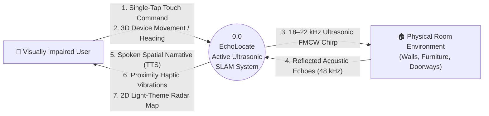
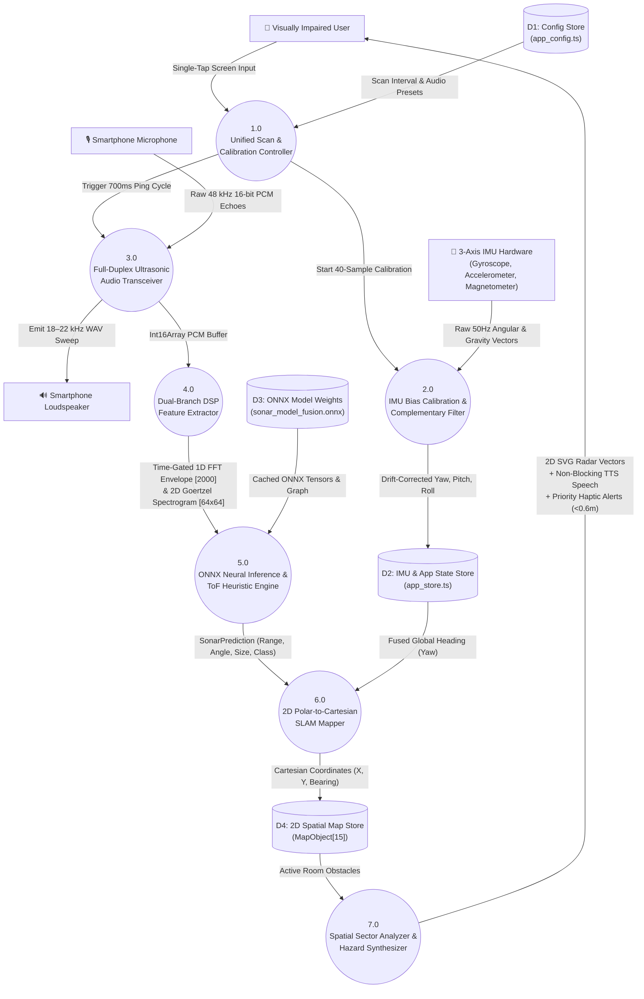

# EchoLocate — State Diagram, Class Diagram & Data Flow Diagram (DFD)

---

## 1. State Diagram

```mermaid
stateDiagram-v2
    [*] --> Initializing : App Launch

    state Initializing {
        [*] --> CopyingONNXAssets : AssetCopyModule.copyAssetToCache()
        CopyingONNXAssets --> LoadingONNXSession : sonar_model_fusion.onnx Ready
        LoadingONNXSession --> InitializingAudioAndTTS : ONNX Runtime / DSP Fallback Ready
        InitializingAudioAndTTS --> [*] : PlayAndRecord & TTS Ready
    }

    Initializing --> Idle : Initialization Complete (Light Theme UI Ready)

    Idle --> Calibrating : User Taps Screen Anywhere (handleSingleButtonPress)

    state Calibrating {
        [*] --> CollectingIMUSamples : Subscribe 50Hz Gyro / Accel / Mag
        CollectingIMUSamples --> ComputingRestingBias : 40 Samples Collected (or 1500ms Timeout)
        ComputingRestingBias --> [*] : Zero Yaw Baseline & Bias Locked
    }

    Calibrating --> Idle : User Taps Screen to Cancel
    Calibrating --> Scanning : Calibration Complete (Speak Confirmation)

    state Scanning {
        [*] --> EmittingUltrasonicChirp : Every 700ms Scan Interval
        EmittingUltrasonicChirp --> CapturingMicrophonePCM : Play 18-22kHz WAV Sweep (20ms)
        CapturingMicrophonePCM --> ExtractingDSPFeatures : 48kHz 16-bit PCM Buffer Received
        ExtractingDSPFeatures --> RunningNeuralInference : 1D FFT Envelope [2000] + 2D Goertzel [64x64]
        RunningNeuralInference --> FusingSpatialCoordinates : Range, Angle, Width, Height, Class
        FusingSpatialCoordinates --> EvaluatingProximityHazard : Polar (r, yaw+θ) -> Cartesian (X, Y)
        EvaluatingProximityHazard --> UrgentHazardAlert : Range < 0.6m
        EvaluatingProximityHazard --> QueuedVoiceNarrative : Range >= 0.6m
        UrgentHazardAlert --> [*] : Heavy Haptic Pulse + Interrupt TTS Warning
        QueuedVoiceNarrative --> [*] : Non-Blocking Sector Speech + Update 2D Radar
    }

    Scanning --> ErrorRecovery : Audio / Sensor / ONNX Exception
    ErrorRecovery --> Scanning : RecoveryStrategies Auto-Restored
    Scanning --> Idle : User Taps Screen Anywhere (Stop Scanning)
```

---

## 2. Class Diagram

```mermaid
classDiagram
    class App {
        +render() JSX.Element
    }

    class SonarDashboard {
        -MapObject[] mapObjects
        -boolean isScanning
        -boolean isCalibratingState
        -boolean ttsReady
        -string lastSpeech
        -boolean isScreenReaderEnabled
        -boolean isSpeakingRef
        +handleSingleButtonPress() void
        +handleNewPrediction(pred: SonarPrediction) void
        +speakText(text: string, isPriority: boolean) void
    }

    class UseSonarAudio {
        +boolean isRecording
        +boolean isPlaying
        +string error
        -Sound chirpRef
        -Int16Array[] accumulatedChunksRef
        +triggerPing() void
        -setupAudio() Promise~void~
    }

    class DspOptimized {
        +number SAMPLE_RATE
        +number SPEED_OF_SOUND
        +Float32Array REFERENCE_CHIRP
        +generateReferenceChirp(sampleRate: number, durationSec: number, fStart: number, fEnd: number) Float32Array
        +computeEnvelope(pcmData: Int16Array, targetLength: number) Float32Array
        +computeSpectrogram(pcmData: Int16Array, rows: number, cols: number) Float32Array
        +extractAcousticDistance(envelope1D: Float32Array) AcousticMeasurement
    }

    class UseSonarInference {
        +boolean isModelLoading
        +SonarPrediction prediction
        +string error
        -InferenceSession sessionRef
        +runInference(spectrogram2D: Float32Array, envelope1D: Float32Array) Promise~void~
        -runDspAcousticInference(envelope1D: Float32Array) void
    }

    class UseSensorFusion {
        +SensorData sensorData
        +CalibrationData calibrationData
        +boolean isCalibrating
        +number calibrationProgress
        +startCalibration(onComplete: Function) void
        +computeDeltaSeconds(rawTimestamp: number, lastTimestamp: number, defaultIntervalMs: number) number
    }

    class MapAnalyzer {
        +generateMapSpeechNarrative(mapObjects: MapObject[]) string
        -getDirectionString(bearingDeg: number) string
    }

    class MapObject {
        +string id
        +number x
        +number y
        +number range
        +number bearingDeg
        +number width
        +number height
        +string type
        +string label
        +number confidence
    }

    class SonarPrediction {
        +number range
        +number angle
        +number width
        +number height
        +string type
        +number confidence
    }

    class ConfigManager {
        -AppConfig config
        +getConfig() AppConfig
        +getAudioConfig() AudioConfig
        +getDSPConfig() DSPConfig
        +getSensorConfig() SensorConfig
        +getUIConfig() UIConfig
        +loadPreset(preset: PresetName) void
        +validateConfig(config: AppConfig) string[]
    }

    class AppStore {
        -AppState state
        -Set~Listener~ listeners
        +getState() AppState
        +setScanning(isScanning: boolean) void
        +addMapObject(obj: MapObject) void
        +setSensorCalibrated(calibrated: boolean) void
        +subscribe(listener: Listener) Function
    }

    class ErrorHandler {
        -ErrorEntry[] errorHistory
        +handleError(error: any, category: ErrorCategory, severity: ErrorSeverity) ErrorEntry
        +getErrorStats() Record
        +clearHistory() void
    }

    class AssetCopyModule {
        +getName() String
        +copyAssetToCache(assetName: String, promise: Promise) void
        -copyCompanionDataIfNeeded(context: ReactApplicationContext, assetName: String, destinationDir: File) void
    }

    App --> SonarDashboard : mounts
    SonarDashboard --> UseSonarAudio : controls acoustic transceiver
    SonarDashboard --> UseSonarInference : triggers neural/DSP inference
    SonarDashboard --> UseSensorFusion : reads fused IMU heading
    SonarDashboard --> MapAnalyzer : synthesizes spoken room narrative
    SonarDashboard --> ConfigManager : reads UI & audio settings
    SonarDashboard --> ErrorHandler : logs & recovers from errors
    SonarDashboard "1" *-- "0..15" MapObject : renders on 2D SVG radar
    UseSonarAudio --> DspOptimized : streams Int16Array PCM
    UseSonarInference --> DspOptimized : calls ToF fallback
    UseSonarInference --> AssetCopyModule : copies ONNX weights via bridge
    UseSonarInference ..> SonarPrediction : produces
    UseSensorFusion --> AppStore : updates calibration & yaw
```

---

## 3. Data Flow Diagram (DFD — Level 0 & Level 1)

### 3.1 DFD Level 0 (Context Diagram)

### 3.2 DFD Level 1 (Detailed System Data Flow)

